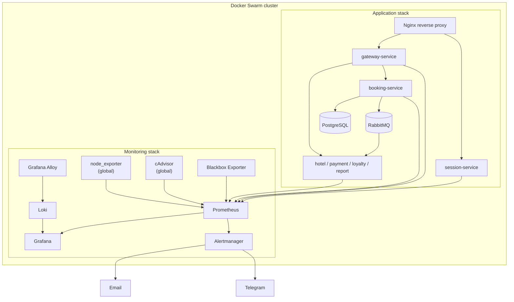

# DO9 — Мониторинг микросервисного приложения

<p align="center">
  
  
  
  
  
  
  
  
  
  
  
  
  
</p>

Проект по построению системы наблюдаемости для микросервисного приложения, развернутого в Docker Swarm. В проекте объединены сбор метрик инфраструктуры и приложения, централизованный сбор логов, визуализация и оповещения о критических состояниях.

> **Материалы проекта**
>
> - [Полное задание School 21](README_RUS.md)
> - [Отчёт о выполнении с конфигурациями и скриншотами](src/REPORT.MD)

## Цель проекта

Развернуть отдельный monitoring stack рядом с приложением в Docker Swarm и получить единое место для анализа состояния инфраструктуры и бизнес-метрик микросервисов.

Решение охватывает три направления:

- **Metrics:** Prometheus собирает метрики узлов, контейнеров, доступности HTTP endpoints и Spring Boot-приложений.
- **Logs:** Grafana Alloy обнаруживает Docker-контейнеры и отправляет их логи в Loki.
- **Visualization & alerting:** Grafana объединяет метрики и логи на дашборде, а Prometheus и Alertmanager формируют и доставляют уведомления о заданных порогах.

## Архитектура



### Состав решения

| Компонент | Назначение |
|---|---|
| Docker Swarm | Оркестрация приложения и monitoring stack |
| Prometheus | Сбор и хранение временных рядов, service discovery и правила алертов |
| node_exporter | Метрики ОС и ресурсов узлов |
| cAdvisor | Метрики контейнеров |
| Blackbox Exporter | Проверки доступности HTTP endpoints |
| Grafana Alloy | Обнаружение Docker-контейнеров и сбор stdout/stderr логов |
| Loki | Хранение и поиск логов |
| Grafana | Дашборд с инфраструктурными и прикладными показателями |
| Alertmanager | Группировка и доставка уведомлений |
| Nginx | Внешняя точка входа к session-service и gateway-service |
| PostgreSQL, RabbitMQ | Хранилище данных и брокер сообщений приложения |

Monitoring stack описан отдельно в `src/docker-compose-monitoring.yml`. Он использует общую overlay-сеть `services_network` приложения и отдельную `monitoring_network`. `node_exporter`, cAdvisor и Alloy запускаются в global mode — по одной задаче на каждой Swarm-ноде. Prometheus, Grafana, Loki и Alertmanager размещаются на manager-ноде.

## Сбор метрик приложения с Micrometer

В Spring Boot-сервисы добавлены зависимости Micrometer и Prometheus registry. Actuator публикует endpoint `/actuator/prometheus`, который опрашивает Prometheus.

Реализованы пользовательские счётчики:

| Метрика Micrometer | Сервис | Что учитывает |
|---|---|---|
| `rabbitmq.messages.sent` | booking-service | Отправленные сообщения RabbitMQ |
| `rabbitmq.messages.processed` | report-service | Обработанные сообщения RabbitMQ |
| `bookings.total` | booking-service | Выполненные бронирования |
| `gateway.requests.total` | gateway-service | Запросы, обработанные методами gateway |
| `auth.requests.total` | session-service | Запросы авторизации |

Счётчики регистрируются через `MeterRegistry` как Spring beans и увеличиваются в точках выполнения соответствующих операций. В Prometheus имена счётчиков экспортируются с суффиксом `_total`, например `bookings_total`.

Prometheus использует DNS service discovery по `tasks.<service-name>` для обнаружения задач микросервисов. Для узлов и контейнеров применяется Docker Swarm service discovery через Docker socket.

## Сбор логов с Loki и Alloy

Для централизованного сбора логов используется Grafana Alloy. Конфигурация `src/monitoring/alloy_config.alloy`:

1. обнаруживает контейнеры через Docker API;
2. извлекает имя контейнера и имя Swarm-сервиса в labels;
3. читает Docker logs;
4. отправляет записи в Loki по адресу `http://loki:3100/loki/api/v1/push`.

Loki хранит chunks и индексы в файловой системе внутри volume `loki_data`. В Grafana Loki подключён как отдельный datasource, поэтому логи можно исследовать рядом с временными рядами Prometheus.

## Дашборд Grafana

Grafana разворачивается отдельным сервисом и подключается к Prometheus и Loki через provisioning datasources. В проекте подготовлен дашборд Docker Swarm с 15 панелями:

- количество Swarm-нод, контейнеров и стеков;
- использование CPU по сервисам, ядрам и узлам;
- занятая RAM, доступная и используемая память;
- количество CPU;
- доступность `google.com`;
- отправленные и обработанные сообщения RabbitMQ;
- количество бронирований;
- запросы к gateway и авторизации;
- логи приложения из Loki.

Экспорт дашборда находится в `src/monitoring/grafana/dashboards/`. Отчёт содержит скриншоты панелей и подтверждение их работы.

## Алерты и доставка уведомлений

Prometheus загружает правила из `src/monitoring/alert-rules.yml` и передаёт сработавшие алерты в Alertmanager.

В конфигурации предусмотрены три группы условий:

| Алерт | Условие в текущей конфигурации | Назначение |
|---|---|---|
| `NodeMemoryAvailableLow` | `node_filesystem_avail_bytes{mountpoint='/'} < 104857600` в течение 2 минут | Контроль свободного места на корневой файловой системе |
| `NodeMemoryUsageHigh` | Используемая RAM больше 1 GiB в течение 2 минут | Контроль потребления памяти узлом |
| `ServiceCPUUsageHigh` | Суммарный CPU сервиса больше 10% одного ядра в течение 2 минут | Контроль CPU-потребления сервиса |

Alertmanager группирует уведомления, задаёт интервалы повторной отправки и направляет сообщения в Telegram и email. Для токенов бота и SMTP-пароля в Swarm используются Docker secrets, подключаемые к контейнеру как файлы из `/run/secrets/`.

> **Важное уточнение по алерту памяти:** фактическое выражение `NodeMemoryAvailableLow` использует `node_filesystem_avail_bytes`, то есть измеряет свободное место на файловой системе, а не доступную RAM. Название и текст уведомления в конфигурации не соответствуют метрике. Для контроля RAM следует использовать `node_memory_MemAvailable_bytes`. Также в комментарии второго правила указано 5 минут, но фактический параметр `for` равен 2 минутам. Эти расхождения нужно исправить перед использованием конфигурации в реальной эксплуатации.

## Развёртывание лабораторного стенда

Инфраструктура виртуальных машин описана в `src/Vagrantfile`:

| VM | Роль | IP | Ресурсы |
|---|---|---|---|
| manager01 | Swarm manager | `192.168.56.10` | 4 CPU, 4096 MB RAM |
| worker01 | Swarm worker | `192.168.56.11` | 2 CPU, 1024 MB RAM |
| worker02 | Swarm worker | `192.168.56.12` | 2 CPU, 1024 MB RAM |

Используется `bento/ubuntu-24.04`. Скрипты в `src/scripts/` устанавливают Docker Engine и инициализируют Swarm: manager сохраняет worker join token в общий каталог, worker-ноды используют его для присоединения к кластеру.

### Подготовка

Перейдите в каталог `src`:

```bash
cd src
```

Создайте локальный `.env` на основе шаблона и заполните параметры приложения:

```bash
cp .env.example .env
```

Поднимите виртуальные машины:

```bash
vagrant up
```

После инициализации Swarm подключитесь к manager:

```bash
vagrant ssh manager01
```

### Развёртывание приложения и мониторинга

Команды ниже выполняются на manager-ноде из каталога `/home/vagrant/src`, куда Vagrant синхронизирует проект.

Разверните приложение:

```bash
docker stack deploy -c docker-compose.yml app
```

Создайте Swarm secrets для Alertmanager (значения вводятся локально; не храните их в репозитории):

```bash
printf '%s' "$TELEGRAM_TOKEN" | docker secret create telegram_token -
printf '%s' "$GMAIL_TOKEN" | docker secret create gmail_token -
```

Разверните monitoring stack:

```bash
docker stack deploy -c docker-compose-monitoring.yml monitoring
```

Проверьте состояние сервисов и задач:

```bash
docker stack services app
docker stack services monitoring
docker stack ps monitoring
```

В конфигурации Compose опубликованы веб-интерфейсы Prometheus и Grafana:

- Prometheus: `http://<manager-ip>:9090`
- Grafana: `http://<manager-ip>:3000`

Остальные внутренние компоненты взаимодействуют по overlay-сети. Фактические адреса и доступность интерфейсов зависят от сетевой конфигурации хоста и виртуальной машины.

## Структура проекта

```text
.
├── README.md
├── README_RUS.md
└── src/
    ├── REPORT.MD
    ├── .env.example
    ├── Vagrantfile
    ├── docker-compose.yml
    ├── docker-compose-monitoring.yml
    ├── nginx.conf
    ├── scripts/
    │   ├── install_docker.sh
    │   ├── manager.sh
    │   └── worker.sh
    ├── monitoring/
    │   ├── prometheus.yml
    │   ├── alert-rules.yml
    │   ├── alertmanager.yml
    │   ├── blackbox.yml
    │   ├── loki_config.yml
    │   ├── alloy_config.alloy
    │   └── grafana/
    │       ├── dashboards/
    │       └── provisioning/
    └── services/
        ├── session-service/
        ├── hotel-service/
        ├── booking-service/
        ├── payment-service/
        ├── loyalty-service/
        ├── report-service/
        └── gateway-service/
```

## Что демонстрирует проект

- Интеграцию Micrometer и Spring Boot Actuator с Prometheus.
- Сбор инфраструктурных метрик Docker Swarm через exporters.
- Service discovery для Swarm tasks.
- Централизованный сбор контейнерных логов через Alloy и Loki.
- Построение Grafana dashboard для инфраструктурных и бизнес-метрик.
- Настройку Prometheus alerting rules и маршрутизацию уведомлений через Alertmanager.
- Использование Docker secrets для передачи токенов в Swarm-сервисы.
- Развёртывание многоузлового лабораторного кластера с помощью Vagrant.

## Ограничения и направления улучшения

Проект демонстрирует базовый end-to-end monitoring pipeline, но не является готовой production-платформой мониторинга. Перед эксплуатацией стоит:

1. Исправить выражение алерта доступной RAM и согласовать длительность срабатывания с текстом уведомления.
2. Не запускать Prometheus с root без необходимости. Доступ к Docker socket даже в режиме read-only требует отдельной оценки: такой socket предоставляет доступ к Docker API и не становится безопасным только из-за `:ro`.
3. Ограничить привилегии cAdvisor и доступ к host namespaces/mounts настолько, насколько позволяет выбранный способ сбора метрик.
4. Вынести пароль администратора Grafana и SMTP/Telegram-параметры в управляемые секреты. Не использовать демонстрационные пароли.
5. Настроить TLS и аутентификацию для внешнего доступа к интерфейсам мониторинга.
6. Настроить резервное копирование и retention для Prometheus, Loki и Grafana с учётом дисковых лимитов.
7. Добавить provisioning самого dashboard из файла экспорта и проверить автоматическую загрузку при чистом развёртывании.
8. Зафиксировать версии образов и регулярно обновлять их с проверкой совместимости и security advisories.
9. Добавить resource requests/limits и стратегию обновления сервисов там, где это поддерживается Swarm.

## Безопасность перед публикацией

В исходном архиве обнаружены чувствительные данные и небезопасные настройки:

- В `docker-compose-monitoring.yml` задан демонстрационный пароль Grafana. Его нельзя использовать в публичной или рабочей среде.
- В `alertmanager.yml` присутствуют персональные параметры получателей уведомлений. Их следует вынести в конфигурацию/секреты и заменить перед публикацией.