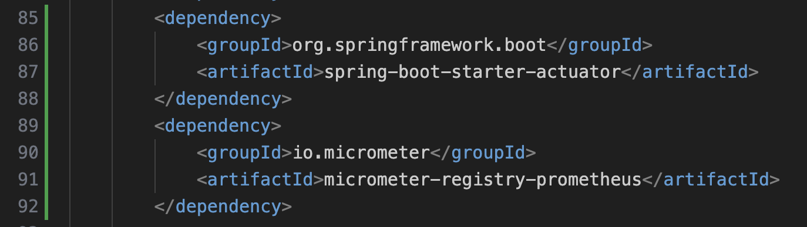
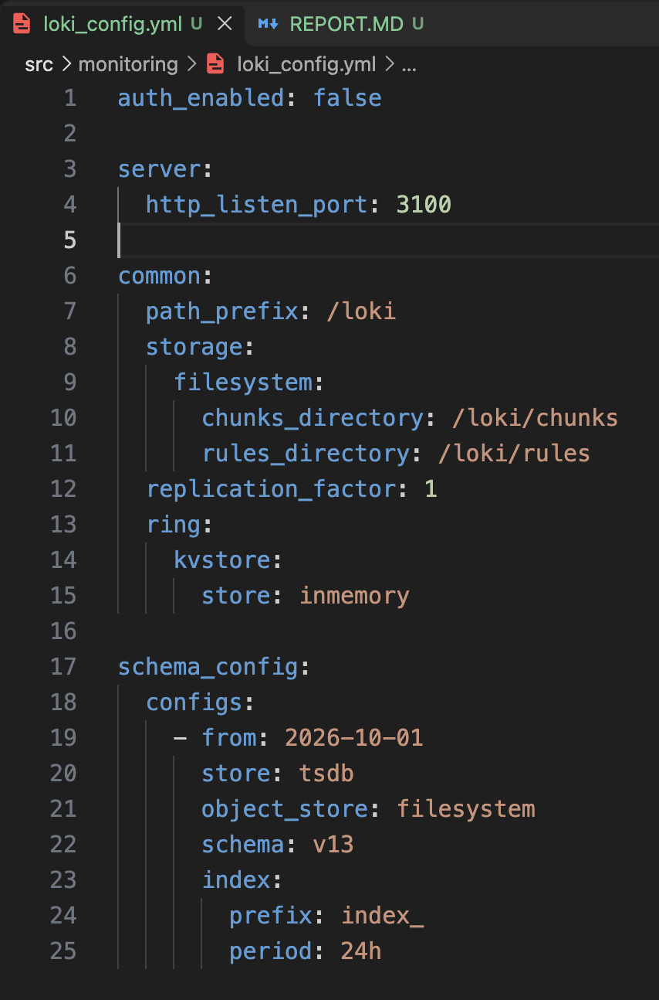
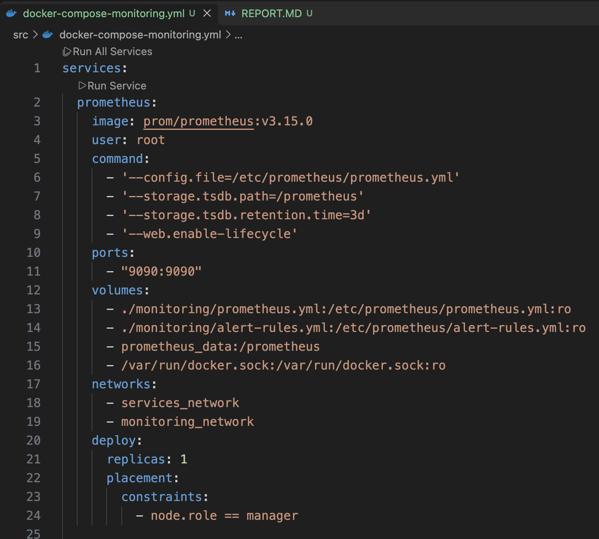
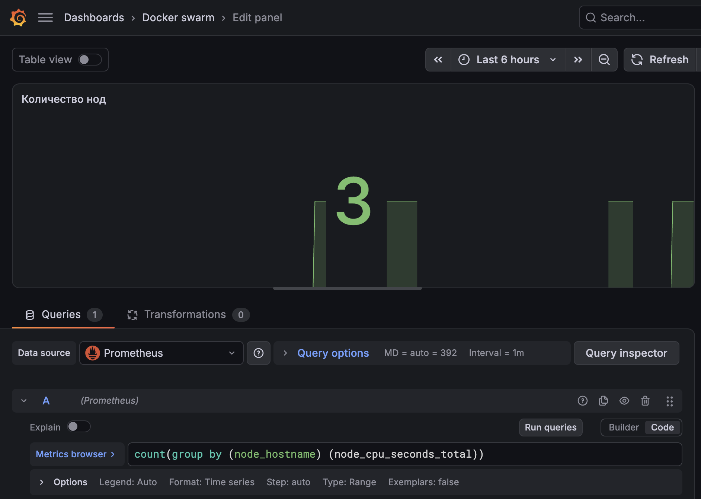
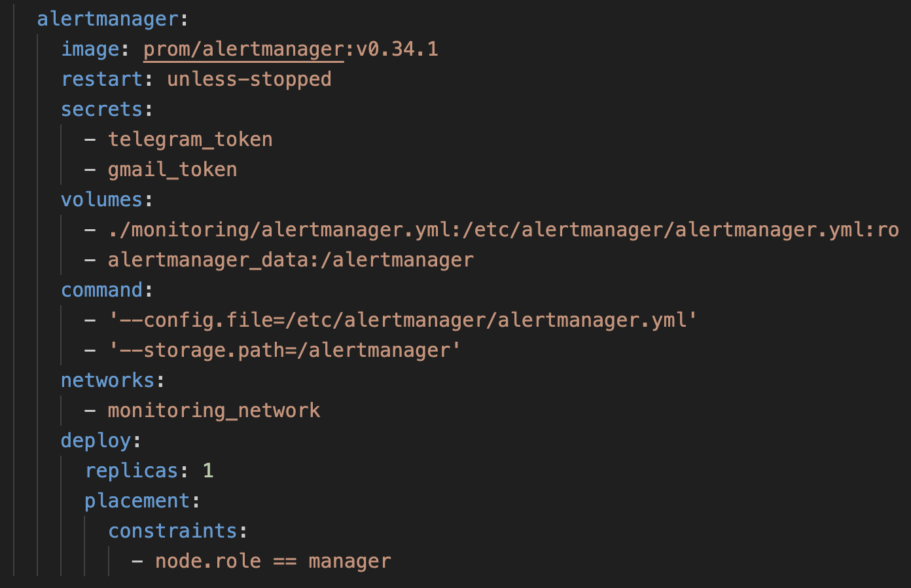

## Part 1. Получение метрик и логов
### Задание

1. Использовать Docker Swarm из первого проекта. 

Перед запуском проекта нужно создать .env файл. Пример в файле .env.example 

2. Написать при помощи библиотеки Micrometer сборщики следующих метрик приложения: 
   - количество отправленных сообщений в rabbitmq;
   - количество обработанных сообщений в rabbitmq;
   - количество бронирований;
   - количество полученных запросов на gateway;
   - количество полученных запросов на авторизацию пользователей.

Пример с booking-service (В других сервисах реализация похожа)
- Добавил новые зависимости в pom.xml файл

- Добавил конфигурацию для метрик в файле application.properties

- Создал счётчики метрик "bookings.total" (Количество бронирований) и "rabbitmq.messages.sent" (Количество отправленных сообщений в rabbitmq)

- Пример того, как подключаются метрики. 1) Импортируется класс Counter (Счётчик). 2) Привязывается наш ранее созданный счётчик *sentMessagesRabbitmqCounter* 3) После отправки сообщения в RabbitMQ значения счётчика увеличивается на 1.


- После сборки я запушил все новые образы в dockerhub с тегом v2 и впоследствии использовал их в docker-compose.yml файле.


3. Добавить логи приложения с помощью Loki.

- Конфигурация Loki


- Для сбора логов приложения используется Alloy (Современная замена устаревшего Promtail). Содержимое файла alloy_config.alloy


4. Создать новый стек для Docker Swarm из сервисов с Prometheus Server, Loki, node_exporter, blackbox_exporter, cAdvisor. Проверить получение метрик на порту 9090 через браузер.

- Я создал отдельный docker-compose-monitroing.yml файл для присоединения стека мониторинга в Docker Swarm.Содержимое файла docker-compose-monitroing.yml



- Конфигурации для сервисов хранятся в директории monitoring:
1) prometheus.yml
- 


2) blackbox.yml
- 

### Запуск стека сервисов, portainer и мониторинга
- Запуск стека с сервисами


- Запуск стека с portainer


- Запуск стека с мониторингом


## Part 2. Визуализация

В этой главе тебе предстоит настроить Grafana для визуализации метрик и логов.

### Задание

1. Развернуть grafana как новый сервис в стеке мониторинга.
- В стек мониторинга добавлена Grafana


2. Добавить в Grafana дашборд со следующими метриками:
   - количество нод;
   - количество контейнеров;
   - количество стеков;
   - использование CPU по сервисам;
   - использование CPU по ядрам и узлам;
   - затраченная RAM;
   - доступная и занятая память;
   - количество CPU;
   - доступность google.com;
   - количество отправленных сообщений в rabbitmq;
   - количество обработанных сообщений в rabbitmq;
   - количество бронирований;
   - количество полученных запросов на gateway;
   - количество полученных запросов на авторизацию пользователей;
   - логи приложения.

1) Количество нод
- 
2) Количество контейнеров
- 
3) Количество стеков
- 
4) Использование CPU по сервисам
- 
5) Использование CPU по ядрам и узлам
- 
6) Затраченная RAM
- 
7) Доступная и занятая память
- 
8) Количество CPU
- 
9) Доступность google.com
- 
10) Количество отправленных сообщений в rabbitmq
- 
11) Количество обработанных сообщений в rabbitmq
- 
12) Количество бронирований
- 
13) Количество полученных запросов на gateway
- 
14) Количество полученных запросов на авторизацию пользователей
- 
15) Логи приложения.
- 


## Part 3. Отслеживание критических событий

В этой главе тебе предстоит настроить Alert Manager для оповещения о критических событиях.

### Задание

1. Развернуть Alert Manager как новый сервис в стеке монтиторинга.
- Был добавлен новый сервис Alert Manager.


### Важно уточнить
Для хранения секретов telegram_token и email_token я использовал docker secret
```
printf "Ваш секретный токен" | docker secret create gmail_token -
printf "Ваш секретный токен" | docker secret create telegram_token -
```

- Содержимое файла alertmanager.yml


2. Добавить следующие критические события:
   - доступная память меньше 100 Мб;
   - затраченная RAM больше 1 Гб;
   - использование CPU по сервису превышает 10%.

- Правила алертов написаны в конфигурационном файле alert-rules.yml


3. Настроить получение оповещений через личные email и Телеграм.
Пример уведомлений. У меня стоит проверка, что "использование CPU по сервису превышает 10%" на ноде вызывает alert. На manager01 данная проверка срабатывает сразу же из-за rabbitmq.

- Письмо в gmail


- Сообщение в телеграмме
